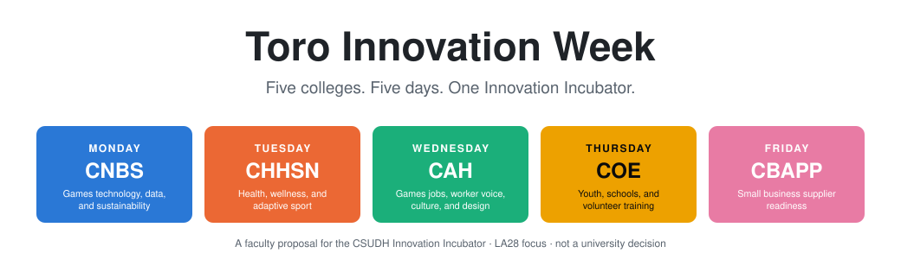
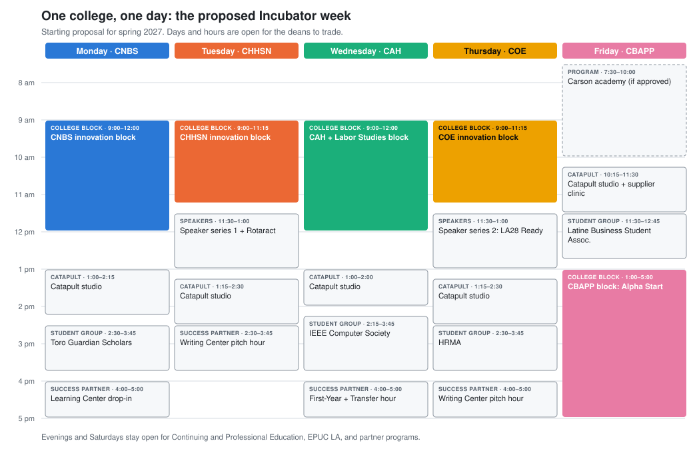
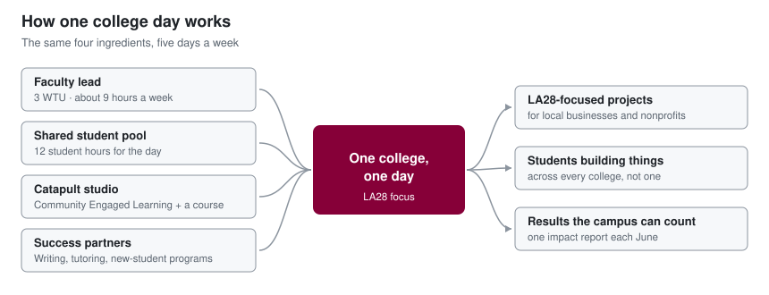
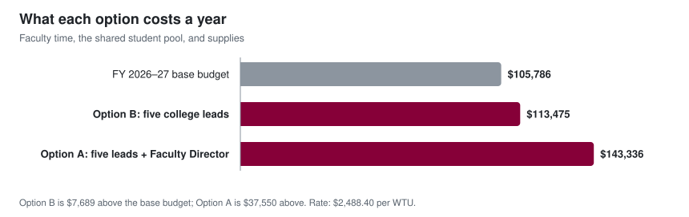
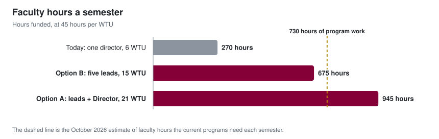
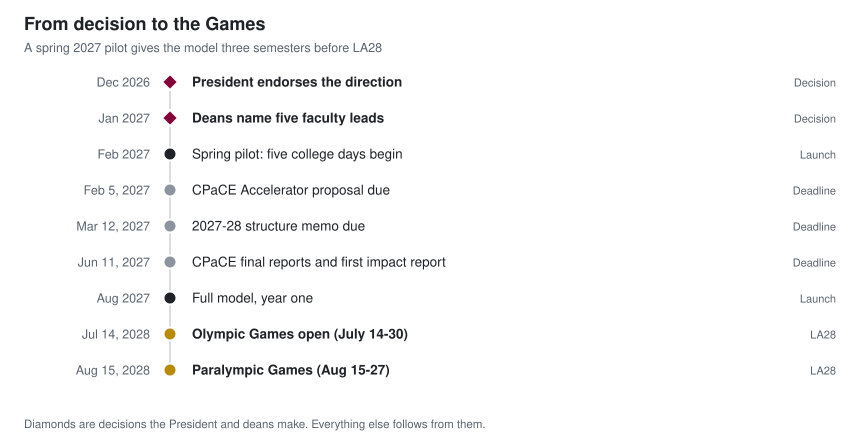

<div align="center">

<picture><source media="(prefers-color-scheme: dark)" srcset="docs/media/charts/hero-dark.svg" /></picture>

<p>A proposal to run the CSUDH Innovation Incubator as a shared campus space:<br/>
each college hosts one day a week, a faculty lead gets 3 WTU to program it around innovation with an LA28 focus,<br/>
and all five share one pool of student staff.</p>

<p><b>Status: a faculty proposal by Thomas J. Norman, Ph.D.. It is a recommendation, not a university decision.</b></p>

<table>
<tr>
<td align="center" width="33%"><h2>5</h2>colleges, one day each</td><td align="center" width="33%"><h2>3 WTU</h2>for each college&#x27;s faculty lead</td><td align="center" width="33%"><h2>75</h2>college days a semester</td>
</tr>
<tr>
<td align="center" width="33%"><h2>2</h2>speaker series, Tuesday and Thursday</td><td align="center" width="33%"><h2>5</h2>student groups meeting weekly</td><td align="center" width="33%"><h2>60</h2>student hours a week, shared by all five</td>
</tr>
</table>

[The week](#-the-week) · [How a day works](#-how-one-college-day-works) · [Two options](#-two-ways-to-staff-it) · [Results so far](#-results-so-far) · [Targets](#-what-success-looks-like) · [Partners](#-student-success-partners) · [LA28](#-why-now-la28) · [Roadmap](#-roadmap) · [Sources](#-sources)

</div>

---

## 🧭 The idea in one minute

<table>
<tr>
<td width="33%" valign="top">

### 📅 One college, one day
Each of the five colleges takes a weekday in the Incubator. The college decides the programming, and its students and faculty fill the room.

</td>
<td width="33%" valign="top">

### 👩‍🏫 3 WTU for a faculty lead
Each college names one faculty lead. Three WTU is 135 hours a semester, about 9 hours a week: one day.

</td>
<td width="33%" valign="top">

### 🤝 One shared student team
The student assistants are one pool of 60 hours a week, so every college day has 12 hours of student help without hiring its own staff.

</td>
</tr>
</table>

Today the Incubator runs on one faculty director with 6 WTU, part-time student assistants, and no staff. The October 2026 estimate puts the current programs at about 730 faculty hours a semester, against 270 hours funded. This proposal spreads the work across the colleges that benefit from it.

## 📅 The week

<picture><source media="(prefers-color-scheme: dark)" srcset="docs/media/charts/week-dark.svg" /></picture>

| Day | College | LA28 focus | Student group that day |
|---|---|---|---|
| **Monday** | Natural and Behavioral Sciences | Games technology, data, and sustainability | Toro Guardian Scholars |
| **Tuesday** | Health, Human Services, and Nursing | Health, wellness, and adaptive sport | Rotaract |
| **Wednesday** | Arts and Humanities, with Labor Studies | Games jobs, worker voice, culture, and design | IEEE Computer Society |
| **Thursday** | Education | Youth, schools, and volunteer training | Human Resource Management Association (HRMA) |
| **Friday** | Business Administration and Public Policy | Small business supplier readiness | Latine Business Student Association |

**What repeats every day**

- **A college innovation block.** The faculty lead runs it: workshops, guest sessions, project time, or a class meeting in the space.
- **A Catapult studio.** Community Engaged Learning pairs with that day's college so student teams do real client projects inside courses. Catapult belongs to all five days.
- **A student group.** Five groups get a weekly home: IEEE Computer Society, Rotaract, the Latine Business Student Association, Toro Guardian Scholars, and HRMA.

**Two speaker series, on different days**

- **Tuesday, 11:30–1:00:** the existing lunch series with Rotaract.
- **Thursday, 11:30–1:00:** a new *LA28 Ready* series on winning Games work, for students and local business owners.

<details>
<summary><b>Starting ideas for each college's LA28 focus</b></summary>
<br/>
<table>
<tr><td width="24%" valign="top"><b>Monday</b><br/>Natural and Behavioral Sciences</td><td valign="top">• Student teams map transit, heat, and crowd data for Carson and campus venues<br/>• Computing and systems students build simple tools for local suppliers<br/>• Sustainability projects tied to the five Olympic and three Paralympic sports on campus</td></tr>
<tr><td width="24%" valign="top"><b>Tuesday</b><br/>Health, Human Services, and Nursing</td><td valign="top">• Paralympic sports on campus as a focus for adaptive-sport and accessibility ventures<br/>• Visitor and community health projects with local clinics and nonprofits<br/>• Wellness ventures from the SDSU Social Venture Challenge pipeline</td></tr>
<tr><td width="24%" valign="top"><b>Wednesday</b><br/>Arts and Humanities, with Labor Studies</td><td valign="top">• Labor Studies tracks Games hiring and job quality for South Bay workers<br/>• Design, media, and language students serve local makers and vendors<br/>• Cultural programming that tells the story of Carson and Compton</td></tr>
<tr><td width="24%" valign="top"><b>Thursday</b><br/>Education</td><td valign="top">• Games-themed lessons and field projects with local schools<br/>• Training for student volunteers and community hosts<br/>• Youth entrepreneurship days with partner programs</td></tr>
<tr><td width="24%" valign="top"><b>Friday</b><br/>Business Administration and Public Policy</td><td valign="top">• RAMP LA registration, county certification, and a capability statement for each business<br/>• Alpha Start bootcamps for student founders<br/>• Carson Small Business Academy, if the City approves a new agreement</td></tr>
</table>

These are conversation starters. Each college sets its own program.
</details>

## ⚙️ How one college day works

<picture><source media="(prefers-color-scheme: dark)" srcset="docs/media/charts/day-dark.svg" /></picture>

## ⚖️ Two ways to staff it

<picture><source media="(prefers-color-scheme: dark)" srcset="docs/media/charts/cost-dark.svg" /></picture>

| | Option B: five college leads | Option A: five leads + Faculty Director |
|---|---|---|
| Faculty time a semester | 15 WTU (675 hours) | 21 WTU (945 hours) |
| Faculty time a year | $74,652 | $104,513 |
| Shared student pool | $34,560 | $34,560 |
| Supplies and printing | $4,263 | $4,263 |
| **Total a year** | **$113,475** | **$143,336** |
| Above the $105,786 base budget | $7,689 | $37,550 |
| Who coordinates | The five leads, with one chairing each semester | A Faculty Director (6 WTU a semester) |
| Best when | Money is tight and Undergraduate Studies can hold the budget | The campus wants one accountable leader for sponsors and LA28 |

<picture><source media="(prefers-color-scheme: dark)" srcset="docs/media/charts/hours-dark.svg" /></picture>

Option B funds 675 hours against an estimated 730, so it works only if Community Engaged Learning carries Catapult and the colleges add their own time. Option A covers the full estimate with room for open hours.

<sub>Costs use Academic Affairs' rate of $2,488.40 per WTU and 45 hours per WTU a semester. The student pool is 60 hours a week for 32 weeks at $18 an hour. The base budget includes a vacant half-time Executive Director line of $42,162; both gaps assume that line stays and funds faculty time. Without it, the gaps are $49,851 (B) and $79,712 (A).</sub>

## 📈 Results so far

The Incubator already produces results with one part-time director. These are from campus records for 2026.

<table>
<tr>
<td align="center" width="33%"><h2>146</h2>students in Catapult courses, fall 2026<br/><sub>3 courses, 16 client organizations</sub></td><td align="center" width="33%"><h2>16</h2>community clients served by Catapult teams<br/><sub>fall 2026</sub></td><td align="center" width="33%"><h2>7 of 8</h2>prizes won by CSUDH teams at Arevon AIRE 2026<br/><sub>16 teams, $28,000 in prizes</sub></td>
</tr>
<tr>
<td align="center" width="33%"><h2>90%+</h2>completion in EPUC LA, the Compton founder program<br/><sub>with Notre Dame&#x27;s UPBI</sub></td><td align="center" width="33%"><h2>8</h2>Carson Small Business Academy cohorts to date<br/><sub>City of Carson partnership</sub></td><td align="center" width="33%"><h2>5</h2>student teams applied for the SDSU Social Venture Challenge<br/><sub>13 students, November 2026</sub></td>
</tr>
</table>

## 🎯 What success looks like

Proposed targets for the first full year. Each would be set with the deans and reported every June.

<table>
<tr>
<td align="center" width="33%"><h2>200</h2>unique students a year, counted once</td><td align="center" width="33%"><h2>10</h2>Catapult courses a year, one per college each semester</td><td align="center" width="33%"><h2>24</h2>speaker talks a semester across two series</td>
</tr>
<tr>
<td align="center" width="33%"><h2>15</h2>local businesses served and registered on RAMP LA</td><td align="center" width="33%"><h2>8</h2>Alpha Start bootcamps a year</td><td align="center" width="33%"><h2>5</h2>student groups meeting weekly in the space</td>
</tr>
</table>

## 🧑‍🎓 Student success partners

The space should also serve students who have never thought of themselves as founders. Three campus units and Community Engaged Learning each get a regular hour and a goal.

| Partner | Role in the week | Starting goal |
|---|---|---|
| **Writing Center** | Pitch and proposal hours, twice a week | 60 students a semester get feedback on a pitch, grant, or capability statement |
| **First-Year and Transfer Experience** | A weekly hour that brings new Toros into the space | 100 first-year and transfer students attend a college day in their first term |
| **Toro Learning & Testing Center** | Weekly drop-in help with the numbers behind a venture | 50 tutoring visits a semester on pricing, budgets, and spreadsheets |
| **Community Engaged Learning** | Runs the Catapult studio with each college, every day | One Catapult course in every college each semester |

<sub>Goals are starting points to confirm with each unit.</sub>

## 🏟 Why now: LA28

- The stadium complex on the CSUDH campus is set to host five Olympic and three Paralympic sports in 2028.
- LA28's procurement plan aims 25% of its addressable spending at small businesses and 75% at the Los Angeles region.
- LA County's *Path to 2028* runs business readiness workshops that campuses and cities can co-host.
- LA28's *Made for Two-Eight* licensing program for small local makers takes applications into February 2027.

An LA28 focus gives every college a reason to use the space and gives Carson, Compton, and South Bay businesses a campus partner while the contracts are still open.

## 🗺 Roadmap

<picture><source media="(prefers-color-scheme: dark)" srcset="docs/media/charts/roadmap-dark.svg" /></picture>

**What it takes to start in spring 2027**

1. The President endorses the college-day direction and chooses Option A or B.
2. Each dean names a faculty lead and confirms a day.
3. Undergraduate Studies and Community Engaged Learning agree on how Catapult runs across the five days.
4. The Writing Center, First-Year and Transfer Experience, and the Toro Learning & Testing Center confirm their hours and goals.

## 🛠 Run it yourself

```bash
pip install pyyaml pytest
python -m pipeline.build     # redraws every chart, this README, and site/index.html
pytest -q                    # checks the arithmetic and the calendar
```

Change a rate, a day, or a block in [`data/model.yaml`](data/model.yaml) and everything else follows.

## 📚 Sources

- Academic Affairs, Office of the Provost. (2026, November 9). FY 2026–27 Innovation Incubator budget, balances, and WTU rate [campus record].
- CSUDH Innovation Incubator. (2026, October 23). Spring 2027 faculty-time estimate by program [campus record].
- CSUDH Innovation Incubator. (2026, November 11). Assessment and participation data, fall 2026 [campus record].
- California State University, Dominguez Hills. (2026). Division of Academic Affairs. Academic Catalog 2026–2027. https://catalog.csudh.edu/general-information/division-academic-affairs/
- Dignity Health Sports Park. (n.d.). About us. https://www.dignityhealthsportspark.com/about/about-us
- LA28. (2026, April 8). LA28 details procurement strategy to boost regional economy. https://la28.org/en/newsroom/la28-details-procurement-strategy-to-boost-regional-economy.html
- LA28. (2026, October 20). LA28 opens its brand to local businesses through new Made for Two-Eight license program. https://la28.org/en/newsroom/la28-opens-its-brand-to-local-businesses-through-new-made-for-two-eight-license-program.html
- Los Angeles County Department of Economic Opportunity. (n.d.). Path to 2028. https://opportunity.lacounty.gov/pathto2028/
- Fresno State, Lyles Center for Innovation and Entrepreneurship. (n.d.). Johanson Entrepreneurship Faculty Fellows. https://craig.fresnostate.edu/lyles/johansonworkshops.html

Campus records are not posted online. Dollar figures and counts come from them as of the dates shown; program results are as reported by the Incubator and have not been independently audited.

## ℹ️ About

Prepared by Thomas J. Norman, Ph.D., Professor of Management and Interim Faculty Director of the CSUDH Innovation Incubator, 2026-11-24. This is an independent faculty proposal. It is not an official publication of California State University, Dominguez Hills, and nothing in it has been approved by the university. Days, hours, leads, and goals are proposals until the colleges and units named here agree to them. See [NOTICE.md](NOTICE.md).
